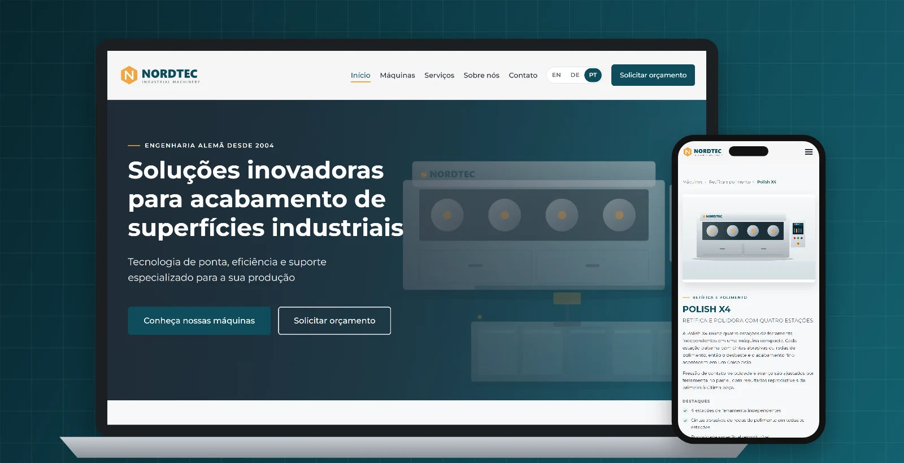
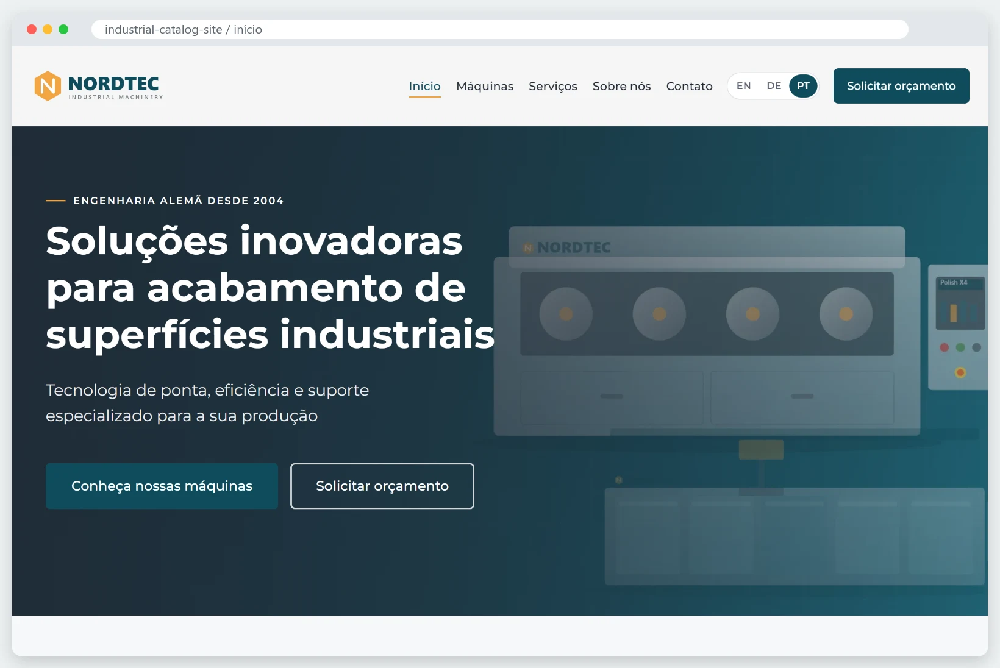
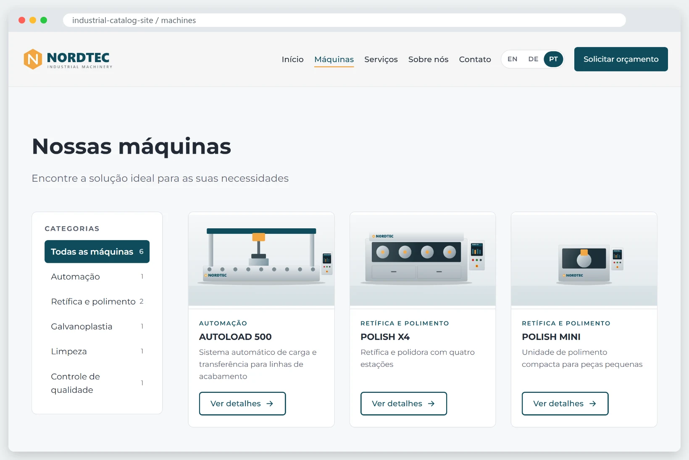
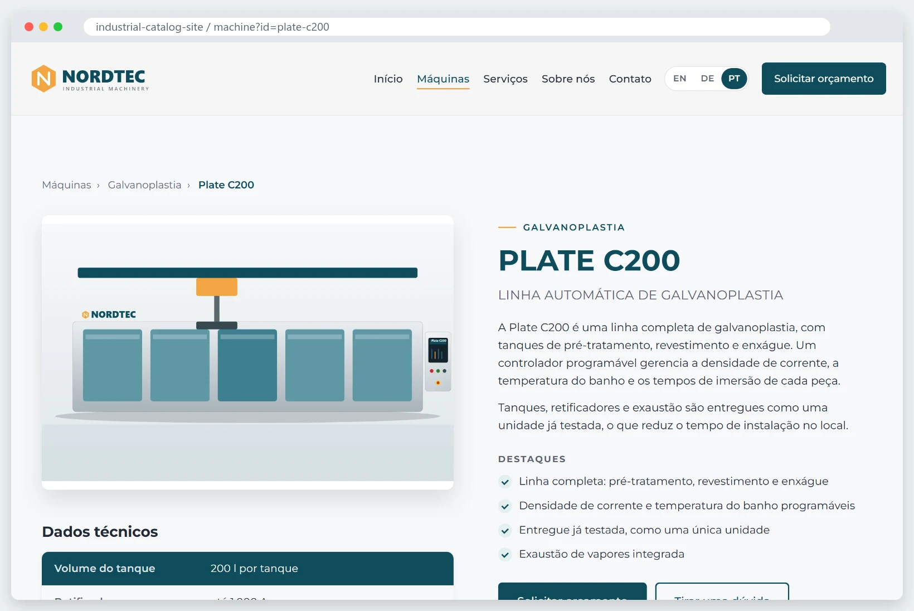
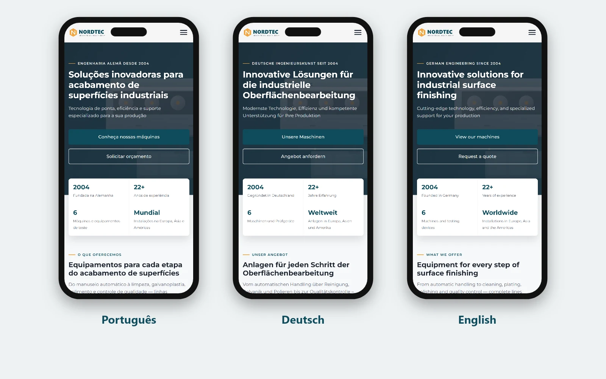

# Catálogo industrial com painel administrativo




**[🔗 Ver demonstração online](https://victorslip.github.io/industrial-catalog-site/)** — catálogo e idiomas funcionando. O painel e o envio do formulário precisam de PHP, então rodam só localmente ou em hospedagem.

Site institucional e catálogo de máquinas industriais, com **painel administrativo próprio** para quem não é da área técnica, **três idiomas** (inglês, alemão e português) e **formulário de contato com envio por SMTP e CAPTCHA**. Feito em HTML, CSS e JavaScript puros no front-end e PHP sem framework e sem banco de dados no back-end, para rodar em qualquer hospedagem compartilhada.

> Projeto desenvolvido para um cliente real. Nesta versão pública, todo o conteúdo foi trocado por uma **empresa fictícia, a "Nordtec Machinery"**. Textos, máquinas, contatos, logo e ilustrações foram criados só para a demonstração.

**English summary:** Corporate website and machine catalog for an industrial manufacturer. Vanilla HTML/CSS/JS front-end that renders everything from a single JSON file, a dependency-free PHP admin panel for non-technical editors, EN/DE/PT-BR translations, an SMTP contact form with CAPTCHA and automatic WebP image conversion. No framework, no database: it runs on plain shared PHP hosting. All company content in this repository is fictional.

---

## Imagens

| Página inicial | Catálogo com filtros |
|---|---|
|  |  |

| Página da máquina | Três idiomas no celular |
|---|---|
|  |  |

---

## Funcionalidades

### Site
- Páginas: início, catálogo de máquinas com filtro por categoria e paginação, página de detalhe da máquina, serviços, sobre e contato.
- **Responsivo**, do celular ao desktop.
- **Três idiomas** (EN / DE / PT-BR) com seletor no topo. O idioma é detectado pelo navegador e lembrado nas próximas visitas.
- Todo o conteúdo vem de um único arquivo, `data/site.json`, renderizado no navegador.
- Página de máquina com destaques, tabela técnica, blocos de recursos com foto, galeria com visualizador (lightbox) e máquinas relacionadas.
- Botões "Solicitar orçamento" e "Tirar dúvida" que já abrem o formulário com o assunto e a máquina preenchidos.
- **Endereços limpos** (`/machines` em vez de `/machines.html`). Links antigos com `.html` redirecionam com 301.

### Painel administrativo (`/admin`)
- Pensado para quem nunca editou um site: tudo em português, com ajuda passo a passo.
- Cadastro de máquinas e categorias nos três idiomas, com fotos, destaques, especificações, recursos e galeria.
- **Fotos otimizadas automaticamente**: convertidas para WebP, reduzidas para no máximo 1600 px e com a rotação de fotos de celular corrigida.
- Edição dos contatos, redes sociais, servidor de e-mail (SMTP) e CAPTCHA.
- Caixa de mensagens recebidas pelo formulário.
- **Backup automático** do conteúdo a cada alteração (guarda os 30 mais recentes em `data/backups`). Fotos de máquinas excluídas vão para uma pasta de recuperação em vez de serem apagadas.

### Formulário de contato
- Envio por **SMTP autenticado** (SSL/TLS), implementado sem bibliotecas externas, com `Reply-To` apontando para o visitante.
- **CAPTCHA** opcional: Cloudflare Turnstile ou Google reCAPTCHA v2, ativados pelo painel.
- Proteção contra spam: campo invisível (honeypot), tempo mínimo de preenchimento, limite de envios por hora e verificação de origem.

### Segurança
- Senha do painel com `password_hash`, bloqueio temporário após tentativas erradas e sessão com cookies `HttpOnly`/`SameSite`.
- Token CSRF em todos os formulários do painel.
- Escrita atômica dos arquivos e validação de UTF-8 antes de salvar (um texto inválido nunca corrompe o conteúdo).
- Upload de imagens validado pelo conteúdo real do arquivo. A pasta de imagens bloqueia a execução de scripts.
- Pastas internas (`admin/private`, `data/backups`) bloqueadas para acesso pela web.
- Sem banco de dados, portanto sem superfície para SQL injection.

---

## Tecnologias

| Parte | Tecnologia |
|---|---|
| Front-end | HTML5, CSS3 (variáveis, Grid, Flexbox), JavaScript puro (ES2020) |
| Back-end | PHP 7.4+ sem framework e sem Composer |
| Dados | Arquivo JSON (`data/site.json`) |
| Imagens | GD (conversão para WebP) |
| Servidor | Apache ou LiteSpeed com `.htaccess` (hospedagem compartilhada comum) |

---

## Estrutura

```
├── index.html, machines.html, machine.html,
│   services.html, about.html, contact.html   Páginas do site
├── css/style.css                             Estilos (cores em variáveis no :root)
├── js/i18n.js                                Textos fixos nos três idiomas
├── js/main.js                                Monta as páginas a partir do site.json
├── data/site.json                            Todo o conteúdo editável
├── img/                                      Logo, ícones, banner e fotos das máquinas
├── api/contact.php                           Recebe o formulário de contato
├── admin/                                    Painel administrativo
│   ├── index.php                             Telas e ações do painel
│   ├── lib.php                               Sessão, segurança, e-mail, imagens, backups
│   └── private/                              Senha, configurações e mensagens (gerado no servidor)
├── .htaccess                                 Endereços limpos
└── router.php                                Endereços limpos no servidor embutido do PHP (só local)
```

---

## Como rodar localmente

Precisa de **PHP 7.4 ou mais novo**. Para o painel converter as fotos para WebP, a extensão **GD** precisa estar ativa.

```bash
git clone https://github.com/victorSlip/industrial-catalog-site.git
cd industrial-catalog-site
php -S localhost:8000 router.php
```

Abra http://localhost:8000. O painel fica em http://localhost:8000/admin/ e, no primeiro acesso, pede para criar a senha.

> Sem o `router.php`, o servidor embutido do PHP não entende os endereços limpos. Em hospedagem Apache/LiteSpeed quem faz isso é o `.htaccess`.

---

## Como publicar

1. Envie todos os arquivos para a pasta pública da hospedagem (por exemplo, `public_html`) por FTP.
2. Acesse `/admin/` e crie a senha do painel.
3. Em **Contato**, configure a conta de e-mail (SMTP) que vai enviar os avisos do formulário.
4. Opcional: ative o CAPTCHA colando as chaves do Cloudflare Turnstile ou do Google reCAPTCHA.

Para trocar a senha esquecida, apague `admin/private/config.php` pelo FTP. No próximo acesso, o painel pede uma senha nova.

---

## Personalizar

- **Cores:** variáveis `--primary` e `--accent` no começo de `css/style.css` e de `admin/admin.css`.
- **Textos fixos** (menu, títulos, página Sobre): `js/i18n.js`, nos três idiomas.
- **Máquinas, categorias e contatos:** pelo painel, ou direto em `data/site.json`.
- **Cache:** ao mudar CSS ou JS, aumente o número em `?v=1` nos arquivos `.html` para os visitantes receberem a versão nova.

---

## Créditos

Desenvolvido por **JOÃO VICTOR** —  [GitHub](https://github.com/victorSlip)

A empresa "Nordtec Machinery", seus produtos, contatos e ilustrações são fictícios.
